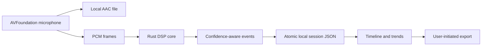

# QuietNight

An original, privacy-first iOS snore journal with a **Rust signal-analysis core** and SwiftUI interface. It responds to recurring complaints in competing apps: lost nights, partner/noise false positives, opaque scores, inaccessible medical implications, and surprise subscriptions.

## What is implemented
- Local overnight AAC recording with microphone permission and background-audio declaration
- Atomic session metadata, interrupted-session marker, timeline-ready events, explicit deletion/export model
- Adaptive-baseline Rust analyzer with RMS, periodicity, confidence, severity, bounded score, C ABI
- Confidence and false-positive warnings for sheets, pets, fans, traffic, and partners
- Factors/remedies-ready session schema and history comparison foundation
- VoiceOver-friendly native controls, Dynamic Type, high-contrast system colors
- No account, ads, cloud upload, locked nights, or subscription

## Build
1. Install full Xcode, Rust, and XcodeGen.
2. `make check && make test`
3. `./scripts/build-rust-ios.sh`
4. `xcodegen generate` and open `QuietNight.xcodeproj`.

The Swift source remains usable without linking the Rust library; production integration should route recorder PCM buffers through `qn_analyze`. Full overnight operation must be tested on a physical iPhone.

## Evidence-driven design
- [Apple App Store reviews](https://apps.apple.com/us/app/snorelab-record-your-snoring/id529443604?see-all=reviews) report partner contamination, sheets/noise false positives, free-night restrictions, and changed scoring.
- [Independent clinical comparison](https://pmc.ncbi.nlm.nih.gov/articles/PMC8304057/) found overestimation and concluded phone snore data should not be used for OSA screening.

## Safety
QuietNight is not a medical device and cannot diagnose or exclude sleep apnea. Consult a clinician for breathing pauses, gasping, or daytime sleepiness.

## REA boundary
REA was checked, but no lawful local SnoreLab IPA/binary was available to inspect. This project therefore uses public behavior/review evidence only and contains no extracted proprietary assets or code.

MIT licensed.
